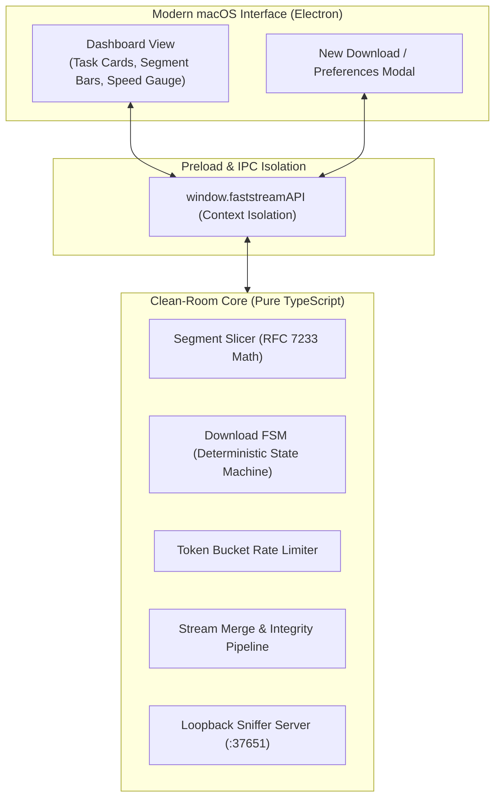

# FastStream 🌊

> **High-Performance, Open-Source Multi-Connection Downloader for macOS (Apple Silicon Native)**  
> 100% Clean-Room Implementation · Pure TypeScript Core · Zero Telemetry · MIT Licensed

[](LICENSE)
[-black.svg)](https://github.com)
[](https://github.com)

---

## ⚡ Highlights

- **Dynamic Range Slicing**: Splits files into 1–32 parallel streams adhering strictly to RFC 7233 / RFC 9110 HTTP Range specifications.
- **Atomic Integrity Validation**: Stream-merges download segments (`.fspart.*`) with automatic byte-for-byte size and SHA256 checksum verification.
- **Live Thread Segment Visualizer**: Real-time progress monitoring showing individual connection download cursors.
- **Browser Media Sniffer Daemon**: Built-in HTTP listener on `127.0.0.1:37651` ready to receive media captures from browser extensions.
- **macOS Native Craftsmanship**: Designed with dark-mode glassmorphism, responsive sidebar, SF Pro typography, and Apple Silicon (`arm64`) native execution.
- **Pure Clean-Room Core**: The core scheduling and slicing engine is implemented as pure, side-effect-free state machines.

---

## 📐 Architecture



---

## 🚀 Quick Start

### Download Prebuilt DMG
Download the latest release DMG from the Releases page:
- **[FastStream-1.0.0-arm64.dmg](release/FastStream-1.0.0-arm64.dmg)**

Double-click to mount the DMG, then drag **FastStream** into your `/Applications` folder.

### Build from Source

#### Prerequisites
- macOS 12+ (Apple Silicon recommended: M1/M2/M3/M4)
- [Bun](https://bun.sh) (v1.2+) or Node.js (v20+)

```bash
# 1. Clone the repository
git clone https://github.com/parkerli6731-lab/faststream.git
cd faststream

# 2. Install dependencies
bun install

# 3. Run cross-verification test suite
bun run test

# 4. Launch in development mode
bun run start

# 5. Build production macOS DMG
bun run dist
```

---

## 🧪 Verification & Audit

FastStream includes built-in verification tools:

```bash
# Run mathematical invariant tests
bun run test

# Run strict intellectual property & clean-room static audit
bash tests/static_audit.sh
```

---

## 📄 License

This project is licensed under the [MIT License](LICENSE).
